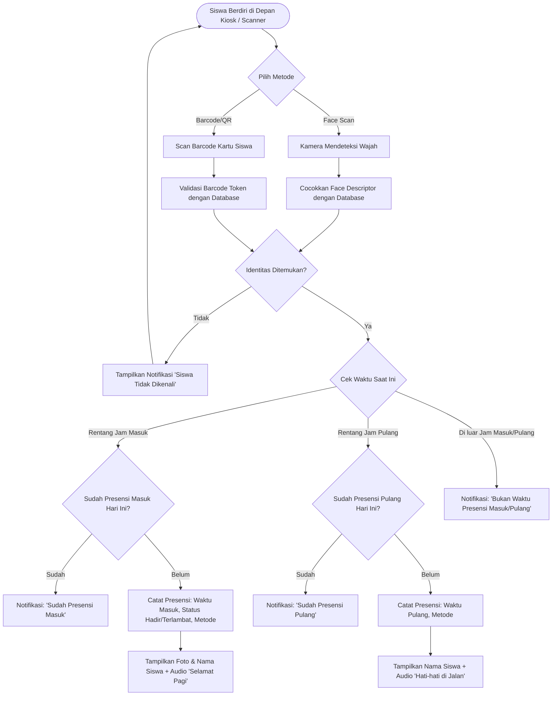
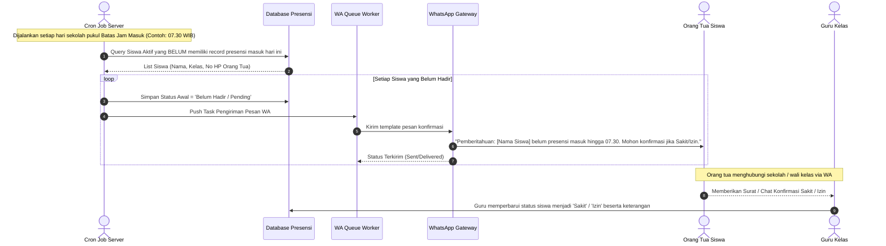
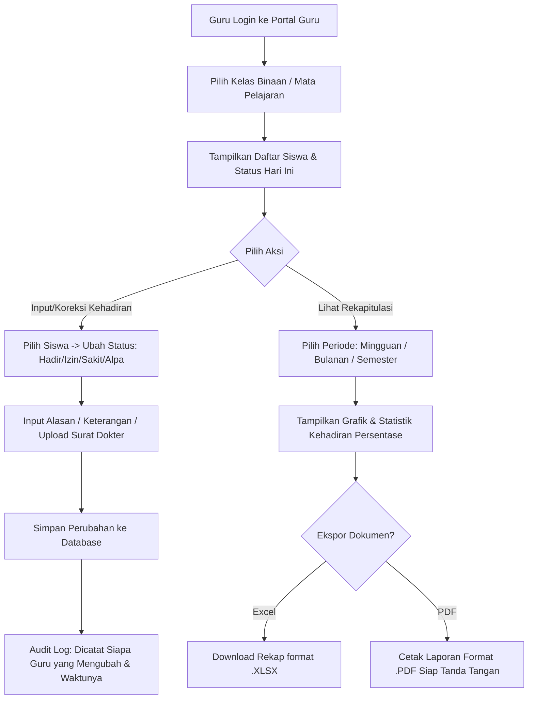
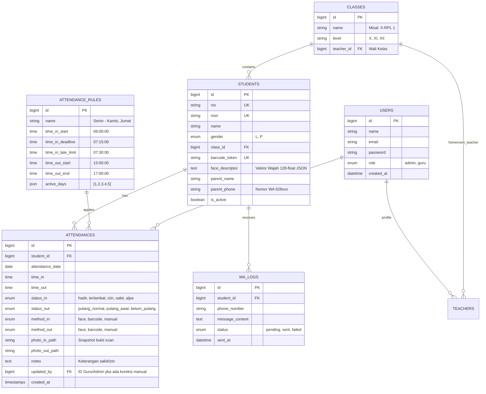

# DOKUMENTASI PROYEK: SISTEM PRESENSI DIGITAL & INFORMASI GURU

Dokumen ini berisi arsitektur sistem, alur proses (flowchart), rekomendasi teknologi (*tech stack*), skema basis data, dan spesifikasi fungsional untuk **Sistem Presensi Digital Sekolah** terintegrasi (Kiosk Face/Barcode + Notifikasi WhatsApp Otomatis) dan **Sistem Informasi Presensi Pengelolaan oleh Guru**.

---

## 1. Ringkasan Sistem (System Overview)

Sistem Presensi Digital ini dirancang untuk mengotomatisasi pencatatan kehadiran siswa di lingkungan sekolah secara akurat, cepat, dan transparan. Terdiri dari 3 subsistem utama:

1. **Kiosk Presensi Mandiri (Frontline Terminal)**:
   - Siswa melakukan presensi dua kali sehari: **Masuk** dan **Pulang**.
   - Metode identifikasi: **Scan Wajah (*Face Recognition*)** atau **Scan Kartu Barcode/QR Code Unik**.
   - Umpan balik langsung visual dan suara (*TTS / Audio buzzer*).
2. **Sistem Notifikasi WhatsApp Otomatis (Cron Scheduler & Queue)**:
   - Jika siswa belum presensi melewati batas toleransi jam masuk (misal: 07.15 WIB), sistem otomatis mengirim pesan WhatsApp ke nomor orang tua/wali untuk verifikasi apakah siswa Sakit, Izin, atau Alpa.
3. **Sistem Informasi & Pengelolaan (Admin & Guru Portal)**:
   - **Portal Admin**: Master data (siswa, kelas, kartu barcode, biometric wajah), pengaturan jam/jadwal, pemantauan dan log menyeluruh multi-filter.
   - **Portal Guru**: Manajemen presensi kelas/perwalian, verifikasi & koreksi kehadiran (jika salah scan/sakit mendadak), rekapitulasi absensi harian/bulanan, serta ekspor laporan (Excel/PDF).

---

## 2. Alur Sistem (System Flowchart & Sequence)

### 2.1. Alur Presensi Siswa (Masuk & Pulang di Kiosk)



---

### 2.2. Alur Notifikasi Otomatis WhatsApp ke Orang Tua (Cron Scheduler)



---

### 2.3. Alur Kerja Guru (Koreksi & Rekapitulasi Kehadiran)



---

## 3. Rekomendasi Tech Stack

Mengingat proyek ini dijalankan pada lingkungan **Laragon (Windows)** yang sudah memiliki **PHP, Node.js, Python, dan MySQL/Redis**, berikut arsitektur teknologi yang paling efisien, stabil, dan mudah dirawat:

### 3.1. Arsitektur Komponen

| Komponen | Pilihan Teknologi Utama | Alternatif | Alasan Pemilihan |
| :--- | :--- | :--- | :--- |
| **Backend Framework** | **Laravel 11 (PHP 8.2+)** | Node.js (Express / NestJS) | Sangat stabil di Laragon, memiliki *Task Scheduler* bawaan untuk cron job WhatsApp, Queue system handal, ORM Eloquent yang kaya untuk filter presensi multi-dimensi, dan otentikasi role-permission yang matang. |
| **Database** | **MySQL 8.0 / MariaDB** | PostgreSQL | Bawaan native Laragon, cepat, andal untuk relasi data siswa, kelas, jadwal, dan puluhan ribu log presensi tahunan. |
| **Frontend UI** | **Tailwind CSS + Alpine.js / Blade** *(atau Inertia.js + Vue 3)* | Bootstrap 5 | Desain modern, bersih, ringan, responsif untuk layar HP guru maupun monitor dashboard admin. |
| **Face Recognition Engine** | **Client-side: `face-api.js` (TensorFlow.js WebGL)** | MediaPipe | Menggunakan TinyFaceDetector + FaceLandmark68Tiny + FaceRecognitionNet untuk pencocokan vektor 128-float langsung pada browser Kiosk dan halaman perekaman biometrik secara *realtime* (< 200ms latency). |
| **QR Code Engine & Scanner** | **QRCode.js** + **jsQR Library** + **Dukungan Scanner USB 2D (HID Keyboard)** | HTML5-QRCode | Kartu pelajar mencetak QR Code beresolusi tinggi. Kamera terminal Kiosk memindai QR Code langsung lewat webcam secara *realtime* maupun lewat scanner tembak USB fisik. |
| **WhatsApp Gateway** | **Baileys (`@whiskeysockets/baileys`)** *(Self-hosted Node.js)* ATAU **Fonnte API / Wawp** | Twilio WhatsApp API | **Baileys**: Gratis, open source, menghubungkan nomor WhatsApp sekolah melalui scan QR (bisa berjalan sebagai service background di Node.js Laragon). Jika ingin tanpa risiko nomor terblokir, dapat menggunakan API Gateway lokal seperti Fonnte. |
| **Queue & Cache** | **Redis** *(Bawaan Laragon)* atau Database Queue | Sync | Mencegah bottleneck saat pengiriman massal pesan WhatsApp agar aplikasi kiosk dan web tetap responsif. |
| **Export Reporting** | **Maatwebsite Excel & DomPDF (Laravel)** | Snappy PDF | Menghasilkan rekap absensi standar format dinas pendidikan dalam format Excel dan PDF siap cetak. |

---

## 4. Perancangan Basis Data (Database Schema)

### 4.1. Entity Relationship Overview



---

## 5. Fitur Rinci per Modul

### 5.1. Kiosk Presensi Mandiri (Frontline Terminal)
- **Tampilan Khusus Layar Penuh (Fullscreen Kiosk Mode)**:
  - Antarmuka ramah pengguna dengan jam digital sinkron server.
  - Dua jendela input: Viewfinder Kamera (untuk Face Recognition) dan Listener Input Barcode (USB scanner / kamera QR).
- **Deteksi Otomatis Masuk vs Pulang**:
  - Jam presensi ditentukan secara dinamis berdasarkan jam berjalan sesuai tabel aturan jam presensi.
  - Jam 06.00 - 09.00: Otomatis memproses **Presensi Masuk**.
  - Jam 14.00 - 17.00: Otomatis memproses **Presensi Pulang**.
- **Pencegahan Double-Tap (Anti Ganda)**:
  - Menolak siswa yang melakukan scan berulang kali dalam jeda singkat jika status masuk/pulangnya sudah tercatat.
- **Visual & Audio Feedback**:
  - Menampilkan foto profil, nama siswa, kelas, status (Hadir / Terlambat), dan waktu presensi.
  - Suara selamat datang yang ramah.

### 5.2. Mesin Notifikasi Otomatis WhatsApp
- **Jadwal Otomatis (Cron Job)**:
  - Berjalan pada menit tertentu setelah jam toleransi masuk berakhir (misal pukul 07.20 WIB).
- **Seleksi Target Cerdas**:
  - Memfilter seluruh siswa aktif pada hari itu yang belum memiliki rekam jejak `time_in` dan belum memiliki keterangan (bukan status izin/sakit yang sudah di-input sebelumnya).
- **Format Pesan Personalisasi**:
  ```text
  Yth. Bapak/Ibu Wali Murid dari *[Nama Siswa]* (*[Kelas]*),

  Kami menginformasikan bahwa ananda belum tercatat melakukan presensi masuk hingga pukul *07.15 WIB* hari ini (*[Tanggal]*).

  Mohon konfirmasi status ananda (Sakit/Izin/Lainnya) dengan membalas pesan ini atau menghubungi wali kelas Bapak/Ibu: [Nama Wali Kelas] ([No WA Wali Kelas]).

  Terima kasih,
  Sistem Presensi Digital - [Nama Sekolah]
  ```
- **Monitoring Antrean**:
  - Dasbor untuk memantau status pengiriman pesan (Pending, Sent, Failed).

### 5.3. Portal Pengelolaan oleh Admin
1. **Master Data Siswa**:
   - Tambah, ubah, nonaktifkan, dan hapus data siswa.
   - Pendaftaran Wajah (Face Enrollment): Mengambil 3-5 pose wajah siswa untuk membentuk *face descriptor* (vektor data wajah).
   - Pembuatan Kartu Barcode: *Generate* token unik QR/Barcode dan tombol cetak kartu pelajar instan.
2. **Master Jam & Aturan Presensi**:
   - Pengaturan jam buka presensi masuk, batas jam tepat waktu, toleransi terlambat, dan jam mulai presensi pulang.
   - Fleksibilitas hari khusus (misal hari Jumat jam pulang lebih awal).
3. **Filter & Monitoring Multi-Dimensi**:
   - **Filter Tanggal**: Harian, rentang tanggal (custom date range).
   - **Filter Siswa**: Pencarian berdasarkan NIS/Nama.
   - **Filter Kelas**: Filter per tingkat (X, XI, XII) dan per rombel/kelas.
   - **Filter Status Kehadiran**: Hadir tepat waktu, Terlambat, Izin, Sakit, Alpa.
   - **Filter Waktu**: Memantau yang belum masuk, sudah masuk belum pulang, dan sudah pulang.
   - **Filter Metode**: Rekap presensi dengan Face vs Barcode vs Manual Guru.

### 5.4. Portal Pengelolaan oleh Guru (Sistem Informasi Presensi Guru)
1. **Dasbor Kelas Binaan / Mata Pelajaran**:
   - Menampilkan ringkasan kehadiran siswa kelas binaannya secara real-time (Berapa anak yang sudah hadir di kelas, berapa yang belum datang).
2. **Pencatatan Kehadiran Cepat (Manual Attendance / Roll Call)**:
   - Guru dapat melakukan absensi manual di dalam kelas jika siswa kelupaan membawa kartu atau terdapat kendala scan wajah.
3. **Koreksi Status Kehadiran**:
   - Mengubah status siswa dari Alpa menjadi Sakit atau Izin saat orang tua mengonfirmasi.
   - Dilengkapi kolom catatan alasan dan unggah foto surat izin/surat keterangan dokter.
4. **Rekapitulasi & Statistik**:
   - Rekap persentase kehadiran per siswa dalam 1 bulan (menghitung persentase kehadiran untuk syarat kelayakan ujian).
5. **Ekspor & Pelaporan**:
   - Unduh rekap format **Microsoft Excel (.xlsx)** dengan pewarnaan otomatis (H, I, S, A).
   - Unduh **PDF Laporan Bulanan** resmi yang dilengkapi kolom tanda tangan wali kelas dan kepala sekolah.

---

## 6. Tahapan Pengembangan (Implementation Roadmap)

| Tahap | Status | Milestone & Aktivitas Utama |
| :--- | :--- | :--- |
| **Fase 1: Fondasi & Basis Data** | **SELESAI (100% Passed)** | Inisialisasi framework Laravel, konfigurasi database, pembuatan 6 migrasi tabel utama (`users` role admin/guru, `classes`, `students`, `attendance_rules`, `attendances`, `wa_logs`), implementasi Model Eloquent + Relasi, Seeder data awal, dan pengujian otomatis via `tests/Feature/DatabaseStructureTest.php` (6 tests, 20 assertions passed). |
| **Fase 2: Master Data & Enrollment** | **SELESAI (100% Passed)** | Sistem Autentikasi multi-role (Admin & Guru), CRUD Rombel Kelas & penugasan wali kelas, CRUD Siswa dengan generator barcode unik otomatis & format nomor WhatsApp 62..., Fitur cetak kartu pelajar standar dengan barcode (JsBarcode), Modul pendaftaran biometrik wajah (*Face Enrollment*) via kamera, CRUD Aturan Jam Presensi (masuk, deadline, late limit, pulang, hari aktif), serta verifikasi otomatis via `tests/Feature/MasterDataTest.php` (11 tests, 40 assertions passed). |
| **Fase 3: Terminal Kiosk Presensi & Optimasi Biometrik/QR** | **SELESAI (100% Passed)** | Antarmuka Kiosk layar penuh gerbang sekolah (`/kiosk`), integrasi **Face AI offline lokal** (`/models/face-api`) dengan HUD feedback realtime (deteksi wajah, status unknown vs matched), pemindai **QR Code 30 FPS hardware-accelerated** (`Html5Qrcode`) dengan dynamic scan box & cooldown responsif 1.5 detik, mesin validasi jam masuk & pulang (`AttendanceService`), proteksi *anti double-tap*, umpan balik audio TTS & visual, modul cetak kartu pelajar dengan **QR Code Jumbo beresolusi tinggi (240px &times; 240px)** siap cetak kertas fisik, halaman Riwayat & Log Presensi Multi-Filter Admin (`/admin/attendances`), serta verifikasi otomatis via `tests/Feature/KioskAttendanceTest.php` (18 tests, 65 assertions passed). |
| **Fase 4: Portal Guru & Rekap** | Dalam Proses | Antarmuka Guru untuk melihat daftar hadir kelas, fitur koreksi status (Izin/Sakit/Alpa), rekap kehadiran bulanan, serta ekspor Excel dan PDF. |
| **Fase 5: WhatsApp Gateway & Scheduler** | Mendatang | Integrasi Node.js Baileys / Fonnte API, setup Laravel Scheduler & Queue Worker untuk pesan otomatis terlambat/alpa ke orang tua. |
| **Fase 6: Pengujian & Peluncuran** | Mendatang | Uji coba *load test* kecepatan scan pada jam sibuk masuk sekolah (06.30 - 07.15), validasi akurasi wajah, dan panduan operasional. |

---

## 7. Rekomendasi Perangkat Keras (Hardware Requirements)

Untuk terminal kiosk di gerbang sekolah:
1. **Komputer Kiosk**: PC/Mini PC (Intel Core i3 Gen 8+ atau setara, RAM 8GB, SSD) dengan OS Windows.
2. **Kamera Web (Webcam)**: Full HD 1080p dengan autofokus dan pencahayaan yang stabil (misal: Logitech C920/C922).
3. **Scanner Barcode/QR**: 2D Omnidirectional Desktop Barcode Scanner (USB Plug & Play) agar siswa cukup meletakkan kartu di depan sensor tanpa harus memegang alat.
4. **Koneksi Jaringan**: Kabel LAN (Ethernet) untuk stabilitas koneksi ke server lokal Laragon / Cloud.


saat melakukan sesuatu seperti membuat fitur atau yang lainnya tolong anailis dlu dan cari data/referensi yang sesuai.
serta pastikan untuk melakukan Test-Driven Loop yaitu:
1. write/modify
2. test
3. analisis jika tes gagal
4. repeat sampai berhasil dan sempurna.

dan Selalu update file dokumentasi serta selalu baca ulang file ini ketika mulai melakukan sesuatu.